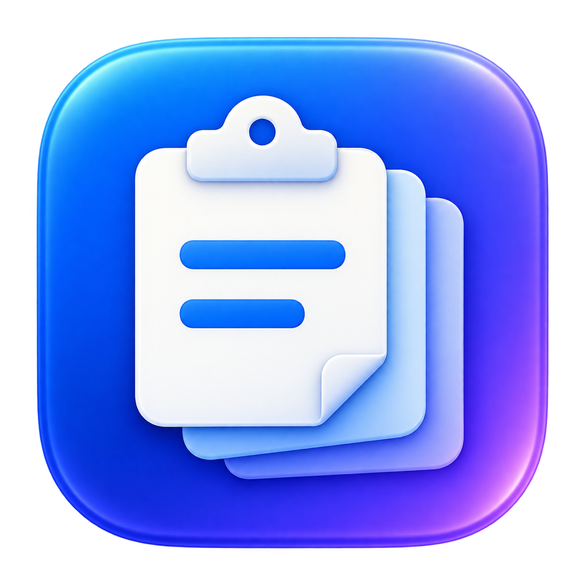

# ClipKeep



轻量、本地优先的剪贴板历史工具。同一仓库维护两个原生实现：**macOS（SwiftUI + AppKit）** 和 **Windows（C# + WPF）**。Windows 是新实现的早期预览，尚未与 macOS 完全对齐。

```text
macos/     Swift 源码、测试与构建脚本
windows/   WPF 桌面程序、可移植核心规则、测试与构建脚本
docs/      平台状态与开发说明
.github/   macOS / Windows 自动构建
```

> 当前为早期源码版本。自动化检查不等于跨应用、中文输入法或系统权限的完整验收。请先用不敏感的示例内容测试。

## macOS 功能
- 自动记录文本、富文本、图片、文件；内容相同的复制会合并成一条并顶到最前
- ⇧⌘V（可在设置里换）从屏幕底部呼出卡片面板：搜索、←→ 选择、⌘C 复制选中卡片并自动收起面板（搜索框有选中文字时优先复制文字，不收起面板）、↩ 粘贴、⇧↩ 粘贴纯文本、⌘D 收藏、⌘⌫ 删除、tab 切换「全部 / 收藏」
- 数字快选：屏幕上可见的卡片角落常驻显示 ⌘1–9（可改 ⌃ / ⌥），按修饰键+数字直接粘贴；可选开启面板收起时的全局快捷键（默认 ⌃⌥+数字，粘贴最近第 N 条，不改变历史顺序）
- 收藏与快捷短语：支持新建、编辑纯文本收藏和设置缩写；匹配时兼容常见中英文标点（如 `;;t`、`；；t`、`;；t` 等价），不改变字母大小写；中文输入法需开启“中文等输入法下也展开”。输入缩写时实时检查等价重复及双向前缀冲突，冲突时禁止保存（编辑时排除当前记录）。
- 保留规则：超过 N 天自动删除（N 在设置里改，0 = 永不删除）、最多保留条数；**收藏的记录永远不会被自动删除**
- 隐私：
  - 密码管理器标记为敏感的内容（`org.nspasteboard.ConcealedType` / `TransientType` 等）一律不记录
  - 可按应用排除（默认排除钥匙串访问、密码、1Password、Bitwarden）
  - 数据库内容用 AES-GCM 加密，密钥在登录钥匙串；去重用带密钥的 HMAC
- 暂停记录、登录时自动启动

## 平台状态

| 平台 | 当前状态 |
| --- | --- |
| macOS Apple Silicon | 原生实现；标准构建和回归检查见下文 |
| macOS Intel | 同一 Swift 源码；CI 单独构建和测试，需查看实际运行结果 |
| Windows 11 x64 | WPF 早期预览；构建、功能与限制见 [Windows 文档](windows/README.md) |

详细缺项见 [平台与发布状态](docs/PLATFORM_STATUS.md)。

## 从源码构建 macOS

需要 macOS 14+、Xcode Command Line Tools（Swift 5.10+）和 Git。

```sh
xcode-select --install  # 尚未安装开发工具时执行

git clone https://github.com/flyingcow-niu/clipkeep.git
cd clipkeep/macos
./test.sh
./build.sh
```

生成 `dist/ClipKeep.app`，默认只编译当前 Mac 的 CPU 架构。GitHub Actions 分别为 arm64 和 x86_64 构建并上传 ZIP 测试产物；不是 Universal 包，也不是经过苹果公证的正式发布包。

本地安装：

```sh
./build.sh --install  # 替换 ~/Applications/ClipKeep.app 并重新启动
```

可选使用本机已有的稳定签名证书（不会自动公证）：

```sh
CLIPKEEP_SIGNING_IDENTITY='你的签名证书名称' ./build.sh
```

安装时会退出旧进程并保留一份旧 App 备份。用户数据不在 App 包中，不随正常安装替换。

## 从源码构建 Windows

在 Windows 安装 **.NET 10 SDK** 和 **PowerShell 7** 后：

```powershell
git clone https://github.com/flyingcow-niu/clipkeep.git
cd clipkeep/windows
pwsh ./test.ps1
pwsh ./build.ps1 -Runtime win-x64
```

输出 `windows/dist/win-x64/ClipKeep.exe`，运行时包含在输出目录中；分发整个目录或 CI ZIP，不能只复制 EXE。它支持托盘、Ctrl+Shift+V、文本／富文本／图片／文件历史、搜索、收藏、复制／粘贴、保留规则及 DPAPI 加密。自动缩写、手动短语管理和登录启动尚未移植。

Windows CI 执行核心规则和 DPAPI／窗口构造检查，并生成便携 ZIP。真实桌面、中文输入法、管理员窗口与多屏仍需手动验收。**当前 ZIP 是未签名预览产物，不是正式安装包。**

## macOS 权限与使用

- 自动粘贴和缩写展开需要「系统设置 → 隐私与安全性 → 辅助功能」授权。没有权限时仍可查看历史、手动复制。
- 默认使用 ad-hoc 临时签名；重新构建或更新后可能需要移除旧授权条目，再添加 `~/Applications/ClipKeep.app`。只运行一个固定安装位置中的版本。
- 钥匙串负责保存数据库密钥；拒绝访问时应用无法读取历史，不会转为明文存储。
- 中文标点匹配支持 `;;t`、`；；t`、`;；t` 等价；中文输入法下需开启“中文等输入法下也展开”。拼音组字和跨应用行为仍需实测。
- 调试面板：`open dist/ClipKeep.app --args --show`。

## macOS 数据与隐私

历史数据位于 `~/Library/Application Support/ClipKeep/clips.sqlite`，密钥保存在登录钥匙串。预览、缩略图和剪贴板载荷加密；来源应用、时间、类型、大小和缩写等元数据没有加密。文件历史保存文件引用，不备份文件本身。

密码标记过滤和应用排除是尽力保护，不能识别所有秘密内容。发布问题反馈前请使用虚构数据，勿上传自己的数据库或剪贴板截图。详细说明见 [SECURITY.md](SECURITY.md)。

## 已知限制

- 未完成 Developer ID 签名、公证和自动更新流程。
- 缺少完整跨应用、输入法、多屏和长期运行验收。
- 长快捷短语借用剪贴板后固定延迟还原；在此期间再次复制内容可能被旧内容覆盖，需后续修复。
- 每次新增记录会全量加载／解密预览，海量历史和图片的性能尚未验证。
- 数据库写入失败反馈、版本迁移、备份与恢复仍需完善。
- Windows 初版与 macOS 的功能及验证状态分别记录。

## 参与开发

参见 [CONTRIBUTING.md](CONTRIBUTING.md)。macOS 使用系统提供的 SQLite、CryptoKit、SwiftUI 和 AppKit，无外部 Swift 包依赖；Windows 使用 .NET 框架和系统 DPAPI，无第三方业务库。图标为本项目生成的视觉资源。

## 许可证

[MIT](LICENSE)，允许使用、修改及分发，须保留许可证和版权声明。
